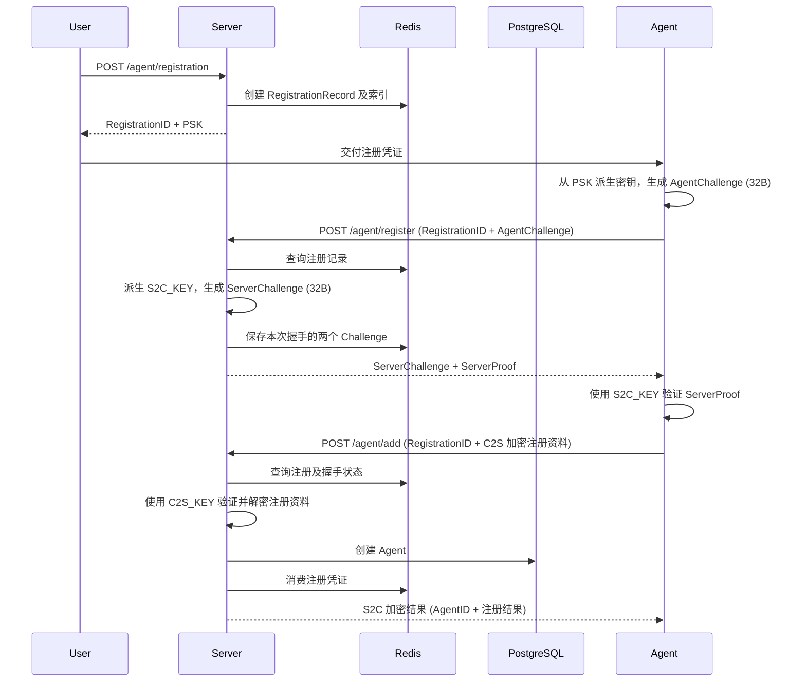

# Agent 注册

用户在 Engine 申请临时注册凭证，再将凭证交给 Agent。以下为后续注册流程设计。Agent 和 Engine 使用 PSK 派生密钥，各自生成挑战并验证对方持有 PSK。双向验证成功后，Engine 在 PostgreSQL 创建 Agent，并消费 Redis 中的临时凭证。

## 注册时序

下图以 `/api/v1` 为接口前缀。



## 挂起注册

已登录且邮箱已验证的用户调用 `POST /api/v1/agent/registration`。Engine 生成 8 字节注册 ID 和 16 字节 PSK，将两者拼接后以无填充的 Base64URL 编码，作为 `registrationToken` 连同 `expiresAt` 返回。

Redis 中的三条记录在同一次 Lua 脚本执行中写入，TTL 均为 5 分钟。同一用户重新申请时，新注册会原子替换旧注册。

| Redis 键                                       | 值                                                                     |
| ---------------------------------------------- | ---------------------------------------------------------------------- |
| `flowloom:agent:registration:{digest}`       | 二进制 `RegistrationRecord`，由 16 字节用户 UUID 和 16 字节 PSK 组成 |
| `flowloom:agent:registration:user:{userId}`  | 该用户当前的注册记录键                                                 |
| `flowloom:agent:registration:owner:{digest}` | 该注册所属用户的索引键                                                 |

`digest` 为注册 ID 的 SHA-256 小写十六进制摘要。

## 派生密钥

双方以 PSK 为 HKDF-SHA256 的输入密钥材料，使用默认的 32 字节全零 salt。`info` 为下列固定字符串的 ASCII 字节，`L` 的单位为字节。注册 ID 和两个 Challenge 在后续验证时绑定到报文。 [RFC 5869 §2](https://www.rfc-editor.org/rfc/rfc5869.html#section-2)

```text
C2S_KEY = HKDF-SHA256(PSK, info="flowloom/registration/c2s/v1", L=32)
S2C_KEY = HKDF-SHA256(PSK, info="flowloom/registration/s2c/v1", L=32)
```

`C2S_KEY` 用于 Agent 发往 Engine 的注册请求。`S2C_KEY` 用于 Engine 返回的挑战证明和注册结果。

## 交换挑战与验证

Agent 从凭证中取出注册 ID 和 PSK，生成随机的 32 字节 `AgentChallenge`，随注册 ID 调用 `POST /api/v1/agent/register`。Engine 查询挂起注册，使用记录中的 PSK 派生 `S2C_KEY`，独立生成随机的 32 字节 `ServerChallenge`。Engine 将两个 Challenge 绑定到本次挂起注册，握手状态的有效期以挂起注册的剩余时间为上限。

该接口可由 Agent 直接调用。请求头 `X-Agent-Registration` 携带注册 ID 的 Base64URL 编码，请求体为 32 字节 `AgentChallenge`，请求和成功响应的媒体类型均为 `application/octet-stream`。响应体为 `ServerChallenge (32) || nonce (12) || tag (16)`。相同 `AgentChallenge` 的重试复用已保存的证明，新的 `AgentChallenge` 替换该注册的握手状态。

双方按固定顺序拼接注册 ID 和两个 Challenge 的原始字节。每种报文的附加认证数据（AAD）由一个报文类型字节和这段握手数据组成。

```text
transcript = registrationId || AgentChallenge || ServerChallenge
serverProofAAD = 0x01 || transcript
registerRequestAAD = 0x02 || transcript
registerResultAAD = 0x03 || transcript
```

Engine 使用 `S2C_KEY` 和 `serverProofAAD` 对空明文执行 AES-256-GCM，得到 `ServerProof`。Engine 返回 `ServerChallenge`、证明的 GCM nonce 和认证标签。Agent 用自己生成的 `AgentChallenge` 重建 AAD，校验认证标签后才提交注册请求。

## 提交注册

Agent 调用 `POST /api/v1/agent/add`，提交注册 ID 和使用 `C2S_KEY`、`registerRequestAAD` 加密的注册资料。Engine 从 Redis 读取两个 Challenge 重建 AAD。请求的 AES-GCM 认证标签验证通过，即完成对 Agent 的验证。随后 Engine 在 PostgreSQL 创建 Agent，使用 `S2C_KEY`、`registerResultAAD` 加密返回 `AgentID` 和注册结果。

每封加密报文携带独立的 12 字节 GCM nonce。同一密钥下不得复用 nonce，尤其是使用 `S2C_KEY` 生成挑战证明和加密注册结果时。 [RFC 5116 §5.2](https://www.rfc-editor.org/rfc/rfc5116.html#section-5.2)

注册成功后，Engine 消费注册记录、两个 Challenge 的握手状态、owner 索引，以及仍指向该注册的用户索引。
